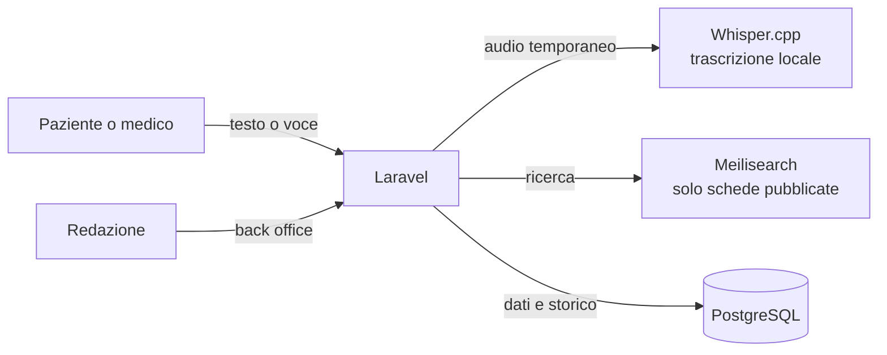

# Arianna – guida ai percorsi di cura per le malattie rare

Chi convive con una malattia rara, o la sospetta, spesso non sa a quale reparto rivolgersi, quale medico può certificarla e come si accede alle cure. **Arianna** è un portale che accompagna pazienti, familiari e medici dentro l'ospedale: dalla ricerca della patologia fino al reparto competente, ai medici certificatori, ai contatti e al percorso di accesso.

Come il filo d'Arianna, serve a non perdersi nel labirinto.

> **Prototipo dimostrativo.** Le due schede incluse usano dati pubblici del [Portale nazionale delle Malattie Rare](https://www.malattierare.gov.it) e sono volutamente incomplete. Il portale non fornisce diagnosi.

*Arianna is a web portal that guides patients through hospital care pathways for rare diseases: fuzzy, synonym and voice search, shareable patient-facing pages with QR codes, and a back office with a role-based editorial workflow.*

---

## Cosa fa

### Portale pubblico

- **Ricerca che perdona**: trova la patologia con il nome ufficiale, un nome incompleto, un errore di battitura, un sinonimo, un acronimo, un codice di esenzione, ICD o Orpha
- **Suggerimenti mentre si scrive**, dal secondo carattere, utilizzabili anche da tastiera
- **Ricerca a voce**: si parla, il testo viene trascritto e cercato. La trascrizione avviene **sul server**, con un modello open source (Whisper): l'audio non viene salvato né inviato a servizi esterni
- **Scheda della patologia**: reparto competente, medici certificatori, contatti, percorso di accesso e fonti con la data di verifica
- **Link stabile e QR code** per ogni scheda, scaricabile in SVG per la stampa (per esempio su un volantino in sala d'attesa)

### Back office

- **Quattro ruoli** con permessi distinti, applicati dal server: amministratore, redattore, validatore, Direttore UOC
- **Flusso editoriale completo**: Bozza → In validazione → Da autorizzare → Autorizzata → Pubblicata → Ritirata
- **Bozza separata dalla versione pubblica**: mentre si modifica una scheda, i pazienti continuano a vedere quella approvata
- **Note obbligatorie** per rinvii e ritiri, e **storico permanente** di ogni passaggio (chi, quando, cosa, perché)
- **Osservatorio delle ricerche**: cosa cercano le persone, quali ricerche non trovano risposta e quali schede vanno completate per prime, con dati minimizzati (nessun IP né identificativo personale)

## Come è fatto



| Componente | Ruolo |
|---|---|
| Laravel 13 · PHP 8.4 | applicazione, portale e back office |
| PostgreSQL 17 | archivio delle schede, delle bozze e dello storico |
| Meilisearch + Laravel Scout | ricerca tollerante ai refusi, sinonimi e autocompletamento |
| Whisper.cpp | trascrizione vocale in italiano, su CPU, senza servizi esterni |
| Docker Compose | ogni servizio in un container isolato |

**Il dato nasce strutturato.** Ogni patologia ha una sola scheda, descritta da uno [schema JSON](docs/scheda_patologia.schema.json): nomi, sinonimi, termini colloquiali, codici, reparti, medici, contatti, percorso di accesso, fonti, stato editoriale e completezza. La stessa scheda alimenta ricerca, pagina pubblica, back office e storico. Nell'indice di ricerca entrano solo le versioni pubblicate.

## Sicurezza e privacy fin dal progetto

- Database, motore di ricerca e trascrizione **non sono esposti**: comunicano solo su una rete interna
- In locale è pubblicata solo l'applicazione, e solo su `127.0.0.1`
- **Segreti fuori dal codice**: tutto passa da variabili d'ambiente (vedi `.env.example`)
- Container con privilegi minimi e limiti di memoria e CPU
- Accesso al back office con **limite ai tentativi** di login
- L'audio della ricerca vocale è temporaneo; l'osservatorio raccoglie solo dati aggregati

## Testato

**41 test automatici** coprono importazione dei dati, pagine pubbliche, QR, autenticazione, permessi dei ruoli, modifica delle bozze, transizioni del flusso, pubblicazione, ritiro e osservatorio delle ricerche.

```bash
cd app
composer install
php artisan test
```

## Dal collaudo: perché la ricerca a voce non basta

Provando il portale come lo userebbe un paziente, è emerso un limite che nessun requisito scritto prevedeva. La frase *"Sto cercando Kallmann"* veniva trascritta correttamente, ma non dava risultati, perché il sistema cercava la frase intera. Ripulire le formule introduttive risolve i casi semplici. Non risolve però il caso reale: **chi non conosce il nome della malattia** descrive sintomi, età, una diagnosi sospetta, un referto ricevuto.

La prossima evoluzione è quindi un **orientamento guidato in linguaggio naturale**: poche domande brevi, proposte di schede, reparti o contatti pertinenti, e un passaggio a una persona quando il caso è incerto. Sempre senza formulare diagnosi né presentare l'associazione tra sintomi e malattie come una certezza clinica.

## Avvio in locale

Servono Docker e Docker Compose.

```bash
cp .env.example .env          # poi compila i valori
docker compose -f compose.yaml -f compose.local.yaml up -d --build

# carica le schede di esempio e prepara l'indice di ricerca
docker compose exec app php artisan db:seed --force
docker compose exec app php artisan scout:sync-index-settings
docker compose exec app php artisan scout:import "App\Models\Pathology"
```

Il portale risponde su http://127.0.0.1:8000, il back office su http://127.0.0.1:8000/accesso. Al primo avvio il modello di trascrizione viene scaricato automaticamente.

## Stato del progetto

| Area | Stato |
|---|---|
| Ricerca testuale, suggerimenti, QR | completata |
| Ricerca vocale (trascrizione locale) | completata, livello di base |
| Back office: ruoli, flusso, storico, pubblicazione e ritiro | completato |
| Osservatorio delle ricerche | completato |
| Orientamento guidato in linguaggio naturale | progettato, da realizzare |
| Recupero password, MFA, firma digitale | fuori dal perimetro del prototipo |

---

Progettato e sviluppato da **Daniela P Colmenares** · [danielacolmenares.it](https://www.danielacolmenares.it)
